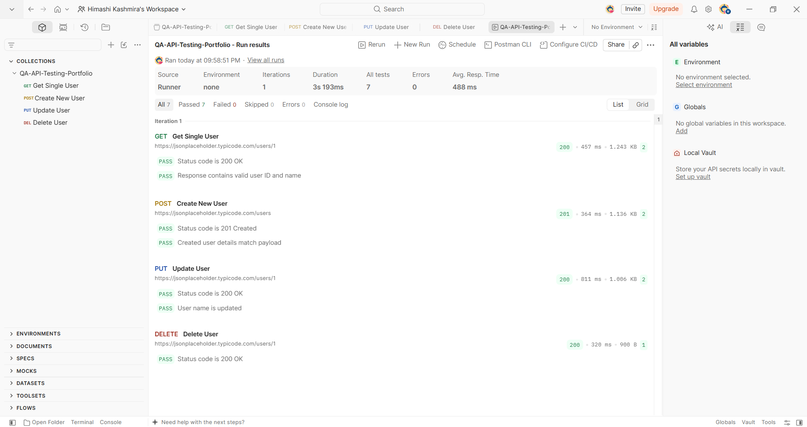

# 🧪 REST API Testing & Automation with Postman

Automated CRUD API test suite built using **Postman** against the JSONPlaceholder REST API (`/users` endpoint), validating HTTP status codes, JSON response payloads, and schema integrity.

## 📌 Endpoints Tested
| Method | Endpoint | Test Scenario | Expected Status |
| :--- | :--- | :--- | :---: |
| `GET` | `/users/1` | Retrieve single user profile details | `200 OK` |
| `POST` | `/users` | Create a new user record with JSON payload | `201 Created` |
| `PUT` | `/users/1` | Full update of an existing user record | `200 OK` |
| `DELETE` | `/users/1` | Remove user record from the system | `200 OK` |

## ✅ Automated Test Assertions (JavaScript / Chai BDD)
- Verified HTTP response status codes (`200 OK`, `201 Created`).
- Asserted JSON payload values (`id`, `name`, `username`) match expected request parameters.
- Executed end-to-end automated regression run via **Postman Collection Runner** (**7/7 Assertions Passed**, Avg. Response Time: `488 ms`).

## 📊 Collection Runner Execution Proof

## 📂 Folder Structure
- `postman-collection/QA-API-Testing-Portfolio.postman_collection.json` — Importable Postman Collection v2.1 with embedded post-response test scripts.
- `screenshots/postman-runner-pass.png` — Automated Collection Runner execution summary.
- `../notes/api-testing-notes.md` — REST API testing concepts, HTTP status codes, and Postman assertion cheat sheet.
