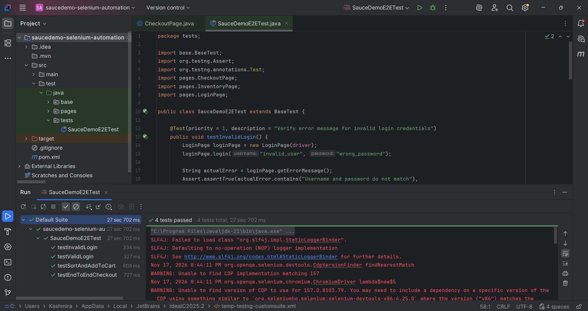

# 🧪 Web UI Test Automation Framework — SauceDemo (Selenium + Java + TestNG)

An automated end-to-end Web UI testing framework built using **Selenium WebDriver**, **Java 21**, **TestNG**, and the **Page Object Model (POM)** design pattern for [SauceDemo](https://www.saucedemo.com/).

---

## 🏗️ Framework Architecture (Page Object Model)

    saucedemo-selenium-automation/
    ├── pom.xml
    ├── README.md
    └── src/test/java/
        ├── base/
        │   └── BaseTest.java          # WebDriver initialization, implicit waits & teardown
        ├── pages/
        │   ├── LoginPage.java         # Login locators & authentication actions
        │   ├── InventoryPage.java     # Product sorting & cart badge interactions
        │   └── CheckoutPage.java      # Checkout form & order confirmation verification
        └── tests/
            └── SauceDemoE2ETest.java  # Automated TestNG regression & E2E test suite

---

## ✅ Automated Test Scenarios

| Priority | Test Method | Scenario Description | Expected Result | Status |
| :--- | :--- | :--- | :--- | :--- |
| **1** | `testInvalidLogin` | Attempt login with invalid credentials | Error message displayed (`Username and password do not match`) | ✅ Pass |
| **2** | `testValidLogin` | Login with valid `standard_user` credentials | User redirected to `Products` inventory page | ✅ Pass |
| **3** | `testSortAndAddToCart` | Sort items (Price: Low to High) & add Backpack to cart | Shopping cart badge updates to `1` | ✅ Pass |
| **4** | `testEndToEndCheckout` | Complete checkout form and submit order | Confirmation message `Thank you for your order!` displayed | ✅ Pass |

---

## 🛠️ Tech Stack
* **Language:** Java 21
* **Automation Tool:** Selenium WebDriver (`4.25.0`)
* **Test Framework:** TestNG (`7.10.2`)
* **Design Pattern:** Page Object Model (POM)
* **Build & Dependency Management:** Apache Maven

---

## 🚀 How to Run
1. Clone the repository:
   `git clone https://github.com/kashmira-dev/qa-portfolio.git`
2. Open the `ui-automation-selenium` project in **IntelliJ IDEA**.
3. Reload Maven dependencies (`pom.xml`).
4. Right-click `src/test/java/tests/SauceDemoE2ETest.java` and select **Run 'SauceDemoE2ETest'**.
5. ---

## 📸 Test Execution Result
