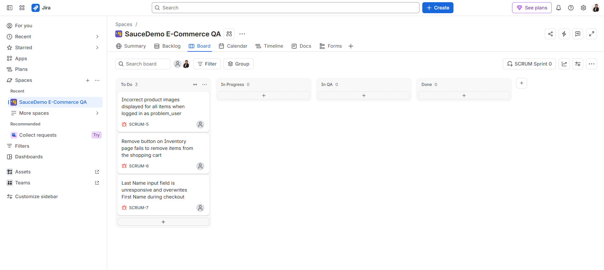

# Mini QA Project: SauceDemo E-Commerce Web Application

## 1. Project Overview
* **Application Under Test (AUT):** SauceDemo E-Commerce Web App (`https://www.saucedemo.com`)
* **Testing Type:** Functional, UI, Boundary & Negative Manual Testing
* **Test Environment:** Windows 11, Brave/Chrome Browser
* **Defect Tracking Tool:** Jira Cloud (`SauceDemo E-Commerce QA`)

---

## 2. Test Execution Summary
* **Total Test Cases Executed:** 8
* **Passed:** 5 (`standard_user`)
* **Failed:** 3 (`problem_user`)

---

## 3. Detailed Test Cases

| Test Case ID | Module | Test Title | Test Steps | Test Data | Expected Result | Actual Result | Status |
| :--- | :--- | :--- | :--- | :--- | :--- | :--- | :--- |
| **TC_SD_01** | Login | Verify login with valid standard user credentials | 1. Go to SauceDemo. 2. Enter valid username & password. 3. Click Login. | User: `standard_user` Pass: `secret_sauce` | User logs in and is redirected to the Inventory page. | Redirected to Inventory page successfully. | **Pass** |
| **TC_SD_02** | Login | Verify login with locked-out user account | 1. Enter locked username & valid password. 2. Click Login. | User: `locked_out_user` Pass: `secret_sauce` | Error message `"Sorry, this user has been locked out."` is displayed. | Error message displayed accurately. | **Pass** |
| **TC_SD_03** | Login | Verify login with invalid password | 1. Enter valid username & wrong password. 2. Click Login. | User: `standard_user` Pass: `wrong123` | Error message `"Username and password do not match..."` is displayed. | Error message displayed accurately. | **Pass** |
| **TC_SD_04** | Inventory | Verify product catalog images display accurately | 1. Log in as `problem_user`. 2. Inspect all product thumbnails on Inventory page. | User: `problem_user` Pass: `secret_sauce` | Each product displays its unique product image. | All products display the same incorrect dog image. | **Fail** |
| **TC_SD_05** | Cart | Verify adding an item to the shopping cart | 1. Log in as `standard_user`. 2. Click 'Add to cart' on Sauce Labs Backpack. | Product: `Sauce Labs Backpack` | Cart badge updates to `1` and button changes to 'Remove'. | Cart badge updated to `1`. | **Pass** |
| **TC_SD_06** | Cart | Verify removing an item from the Inventory page | 1. Log in as `problem_user`. 2. Click 'Add to cart' on Backpack. 3. Click the 'Remove' button. | User: `problem_user` | Item is removed from cart and button reverts to 'Add to cart'. | 'Remove' button is unresponsive; item stays in cart. | **Fail** |
| **TC_SD_07** | Checkout | Verify entering valid shipping information | 1. Log in as `problem_user` and go to Cart -> Checkout. 2. Enter First Name, Last Name, and Zip Code. | First: `Himashi` Last: `Kashmira` Zip: `91000` | All three input fields accept their respective text values. | Last Name field is unresponsive and overwrites First Name. | **Fail** |
| **TC_SD_08** | Auth | Verify user logout functionality | 1. Open left hamburger menu. 2. Click 'Logout'. | N/A | User is logged out and redirected to the Login page. | Redirected to Login page successfully. | **Pass** |

---

## 4. Logged Jira Defects Summary

| Jira Key | Summary | Severity | Priority | Status |
| :--- | :--- | :--- | :--- | :--- |
| **SCRUM-5** | Incorrect product images displayed for all items when logged in as `problem_user` | Major | High | To Do |
| **SCRUM-6** | Remove button on Inventory page fails to remove items from the shopping cart | Major | High | To Do |
| **SCRUM-7** | Last Name input field is unresponsive and overwrites First Name during checkout | Critical | High | To Do |

---

## 5. Jira Defect Tracking Board
